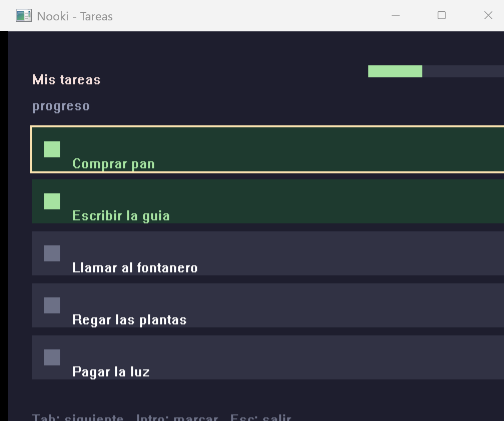

# Nooki

[](https://github.com/Master2020-A/nooki/actions/workflows/ci.yml)
[](https://github.com/Master2020-A/nooki/releases/latest)
[](LICENCIA.md)
[](pruebas/conformidad/)

**Un lenguaje compilado, con sintaxis en español, tipado seguro y memoria determinista.**

Nooki se escribe en archivos `.oki` y se compila a un binario nativo. Usa un compilador de C
(`cc`, `gcc`, `clang` o MSVC) como backend, así que funciona en Windows, macOS y Linux sin runtime
propio.

```aura
usar redes

funcion principal() -> entero {
    variable red = redes.nueva_profunda(2, 12, 3)
    variable punto = Vector<flotante>.nuevo()
    punto.agregar(0.5)
    punto.agregar(0.5)
    redes.ejemplo_profunda(red, &punto, 2)
    redes.entrenar_profunda(red, 8000, 0.3)
    imprimir(redes.predecir_profunda(red, &punto))
    redes.liberar_profunda(red)
    retornar 0
}
```

Ese es un programa completo: 24 líneas, sin dependencias, que **entrena una red neuronal** y la usa.

## Una aplicación de escritorio, en el repositorio



`ejemplos/06-tareas` es un programa con ratón y teclado, escrito entero en Nooki: ventana, botones,
campo de texto, lista y persistencia. Se ejecuta con `nooki ejecutar ejemplos/06-tareas/principal.oki`.

## Datos, modelo y ventana en el mismo programa

`ejemplos/10-clasificador` escribe un CSV, lo lee, entrena una red de dos capas con él y dibuja la
frontera que ha aprendido: en una ventana si hay entorno gráfico, y en caracteres si no.

```
$ nooki ejecutar ejemplos/10-clasificador/principal.oki
muestras:
225
aciertos:
225
sin entorno gráfico; la frontera en caracteres:
o o o + + + + + + + + + + + +
o o o o + + + + + + + + + + +
o o o o o + + + + + + + + + +
...
```

## Qué tiene

| Pilar | Estado |
|---|---|
| Sintaxis sencilla, todo en español | sí |
| Tipos comprobados antes de ejecutar | sí |
| Memoria segura sin recolector: propiedad, movimiento y préstamos | sí |
| OOP completa: clases, herencia, polimorfismo, `super` | sí |
| Genéricos de funciones y de tipos | sí |
| Enumeraciones con datos y emparejamiento | sí |
| Rasgos y despacho por rasgo (`&Rasgo`) | sí |
| Errores como valores (`resultado` y `?`), sin excepciones | sí |
| Colecciones: `Vector<entero>`, `Vector<texto>`, `Vector<flotante>`, `Mapa<texto, entero>`, `Mapa<texto, flotante>` | sí |
| Módulos con visibilidad y proyectos con `biblioteca/` | sí |
| Biblioteca estándar escrita en Nooki | 17 módulos: datos y textos, interfaz gráfica e IA |
| Interfaz gráfica de escritorio | sí (Windows y Linux; macOS compila, sin backend de ventana) |
| Redes neuronales y datos | sí: una y dos capas ocultas, CSV, tensores, tablas |
| Control de hardware (`inseguro`, `asm!`) | `asm!` sí; lo demás, fase posterior |
| **Verificación** | **111 casos de conformidad · 18 suites · Windows, Linux y ASan+UBSan** |

**Versión actual: 1.0.2.** No hay defectos conocidos: todos los huecos de propiedad están cerrados o son
error de compilación. Lo que falta son características planificadas, no fallos.

## Probar sin instalar nada

El repositorio trae nueve programas listos en [`ejemplos/`](ejemplos/):

```bash
$ export PATH="$PWD/build/linux/compilador:$PATH"   # Windows: ver ejemplos/LEEME.md
$ nooki ejecutar ejemplos/01-hola/principal.oki
¡Hola, Nooki!

$ nooki ejecutar ejemplos/04-saludos/principal.oki
Hola, soy Ana
Bip. Unidad R2
```

Cada uno con su explicación en [`ejemplos/LEEME.md`](ejemplos/LEEME.md): módulos, clases con
herencia, rasgos y lectura de la entrada estándar.

## Empezar en tres comandos

```bash
$ nooki nuevo demo
$ cd demo
$ nooki construir
$ ./principal
Hola, Nooki
```

Después:

```bash
$ nooki probar      # ejecuta pruebas/*.oki y compara con su .esperado
$ nooki limpiar     # borra binarios y artefactos
```

El recorrido completo del lenguaje está en la **[guía](GUIA.md)**: diez pasos, cada uno con su
programa y su salida real.

## Compilar el compilador

Requisitos: CMake 3.25 o superior y un compilador de C++20 (MSVC 2022+, GCC 12+ o Clang 15+).

```bash
$ cmake --preset windows-mingw      # o linux, macos, windows-msvc-2026
$ cmake --build --preset windows-mingw
$ ctest --preset windows-mingw
```

El binario queda en `build/<preset>/compilador/nooki.exe`. Para generar un ejecutable y usarlo desde
cualquier sitio, añade esa carpeta al `PATH`.

Presets disponibles: `windows-msvc-2022`, `windows-msvc-2026`, `windows-mingw`,
`windows-mingw-depurar`, `linux`, `macos` y `saneamiento` (AddressSanitizer y UBSan).

## Estructura del repositorio

```
compilador/            código del compilador (C++20)
  fuente/lexico/         análisis léxico
  fuente/sintactico/     parser y AST
  fuente/semantico/      verificación de tipos y propiedad
  fuente/generador/      generación de C
  fuente/conductor/      carga de módulos y cadena de compilación
  fuente/cli/            interfaz de línea de comandos
  pruebas/               pruebas unitarias del compilador
pruebas/conformidad/   programas que se compilan y ejecutan en cada `ctest`
spec/                  especificación del lenguaje
docs/adr/              decisiones de arquitectura
```

## Resaltado de sintaxis

Los archivos `.oki` se colorean en **VS Code**, **Vim/Neovim**, **Sublime Text**, **Zed** y cualquier
editor que lea gramáticas TextMate. Las definiciones están en [`editores/`](editores/), con
instrucciones en [`editores/LEEME.md`](editores/LEEME.md).

```powershell
# VS Code, Windows
Copy-Item -Recurse editores\vscode "$env:USERPROFILE\.vscode\extensions\nooki-1.0.0"
```

## Documentación

- **[Guías por audiencia](docs/guias/LEEME.md)** — usuario, administrador, desarrollador y referencia
  del lenguaje. También en PDF: [usuario](GUIA_DEL_USUARIO.pdf),
  [administrador](GUIA_DEL_ADMINISTRADOR.pdf), [desarrollador](GUIA_DEL_DESARROLLADOR.pdf),
  [referencia](REFERENCIA_DEL_LENGUAJE.pdf).
- **[Guía](GUIA.md)** — aprender el lenguaje desde cero.
- **[Especificación](spec/especificacion-v0.1.md)** — el documento normativo: gramática, tipos,
  sentencias, códigos de diagnóstico.
- **[Decisiones](DECISIONES.md)** — índice de los 26 ADR y de los asuntos abiertos.
- **[Plan de sprints](PLAN_IMPLEMENTACION_NOOKI_SPRINTS.md)** — qué está hecho y qué falta.
- **[Editores](editores/LEEME.md)** — resaltado para VS Code, JetBrains (RustRover, IntelliJ…) y Vim, y cómo conectar el servidor de lenguaje.
- **[Manual](MANUAL.md)** — el lenguaje capítulo a capítulo, con 69 programas que la suite compila.
- **[Referencia](REFERENCIA.md)** — para consultar: tipos, operadores con su precedencia, miembros y los
  46 diagnósticos. Las tablas se generan desde el compilador.
- **[Cambios](CHANGELOG.md)** — qué entró en cada versión.
- **[Notas de la 1.0](NOTAS_DE_VERSION.md)** — qué incluye, qué no y para quién es.

## Cómo se prueba

Cada cambio pasa por tres filtros:

1. **Dieciocho suites** del compilador: léxico, parser, semántica, diagnósticos, CLI, expresiones,
   sentencias, panics, rutas, manifiestos, LSP, ventanas, imágenes, rendimiento y conformidad.
2. **92 programas de conformidad**: los válidos se compilan, se ejecutan y su salida se compara con
   la esperada; los inválidos pasan por léxico, parser y verificación y deben emitir exactamente los
   códigos que declaran.
3. **Fuzzing** (entradas aleatorias contra todas las fases), **benchmarks**, la aritmética comprobada y
   la que comprueba que la documentación no se desincronice.
4. **Ambos compiladores de C**: GCC y MSVC, con `ctest` en los dos, más Linux con `gcc` y con
   `AddressSanitizer` + `UndefinedBehaviorSanitizer`.

De los 46 códigos de diagnóstico, **40 tienen un caso que los provoca**. Los seis restantes necesitan
escenarios que no caben en una prueba automática —una máquina sin compilador de C, uno roto, dos
módulos para el símbolo privado y tres errores del analizador sin disparador estable— y están
anotados con su motivo en `DECISIONES.md`.

## Licencia

MIT o Apache-2.0, a elegir. Ver [LICENCIA](LICENCIA.md).

## Contribuir

Lee [CONTRIBUIR](CONTRIBUIR.md). En resumen: código en C++20 con el estilo del repositorio, mensajes
de commit en español e imperativo, y ninguna característica nueva sin su caso de conformidad.
