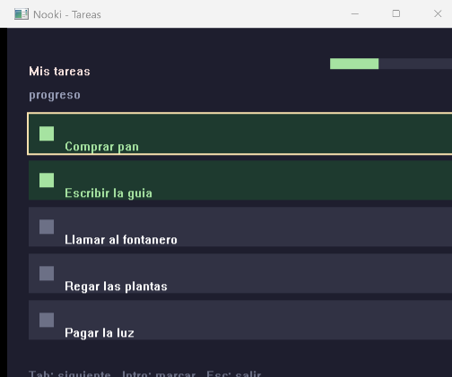

# Interfaz gráfica

Cómo se escribe una aplicación de escritorio en Nooki, y las cosas que conviene saber antes de
intentarlo.



*`ejemplos/06-tareas`: una lista de tareas con foco por teclado, hecha con los cinco módulos de
interfaz.*

## Los módulos

| Módulo | Para qué |
|---|---|
| `ventana` | abrir la ventana, el bucle de eventos, dibujar y leer píxeles |
| `diseno` | colocar las cosas: columnas, filas, centrado, reparto |
| `controles` | etiqueta, botón y barra de progreso |
| `accesibilidad` | contraste legible y foco por teclado |
| `imagenes` | cargar y dibujar BMP |

Los cinco se pueden usar juntos, y solo el primero necesita una ventana.

## El esqueleto

```aura
usar ventana

funcion principal() -> entero {
    variable titulo = "Mi programa" + ""
    variable v = ventana.abrir(&titulo, 520, 460)

    si (v == 0) {
        imprimir("sin entorno grafico")
        retornar 0
    }

    variable dibujar = verdadero
    mientras (ventana.viva(v)) {
        variable pedido = ventana.repintar(v)
        si (dibujar || pedido) {
            ventana.limpiar(v, 0x1E1E2E)
            // ... aquí se dibuja todo ...
            ventana.presentar(v)
            dibujar = falso
        }

        variable e = ventana.evento(v)
        mientras (e != 0) {
            si (ventana.es_pulsacion(e)) {
                variable x = ventana.evento_x(v)
                variable y = ventana.evento_y(v)
                // ...
                dibujar = verdadero
            }
            e = ventana.evento(v)
        }

        ventana.pausa(16)
    }

    ventana.cerrar(v)
    retornar 0
}
```

## Las cinco trampas

Las he encontrado todas escribiendo los ejemplos. Ninguna es obvia.

### 1. Hay que repintar cuando el sistema lo pide

La ventana se destapa, se redimensiona o la redibuja Windows. Si el programa no vuelve a dibujar, el
área queda en blanco. Por eso existe `ventana.repintar(v)`: devuelve verdadero cuando hay que
redibujar.

**Sin esto, la aplicación funciona hasta que alguien pasa otra ventana por encima.**

### 2. `presentar` no hace nada en Windows

En GDI el dibujo llega a la ventana al hacerlo; en X11 necesita un `XFlush`. La función está para que
el mismo programa sirva en las dos plataformas: no la quites, pero no esperes que haga magia.

### 3. `abrir` puede devolver 0

Sin entorno gráfico (un servidor, un contenedor, una sesión sin escritorio) devuelve 0. **No es un
error**: el programa decide qué hacer. Una aplicación debería decir que no puede abrirse y terminar
bien, no reventar.

### 4. En Linux hace falta `libx11-dev` para compilar

Los programas con ventana se enlazan con X11. El compilador en sí no lo necesita; los programas que
usan `ventana`, `controles`, `imagenes` o `accesibilidad`, sí.

```bash
sudo apt install libx11-dev
```

Y para probarlos sin pantalla:

```bash
xvfb-run -a ./programa
```

### 5. Los nombres de controles chocan con las palabras del lenguaje

`texto`, `clase`, `esperar`, `vacio`, `tamano` y `lista` son palabras reservadas. Un control no puede
llamarse así, y una variable tampoco:

```aura
// error[NOK2002]: se esperaba un nombre de variable y se encontró «clase»
variable clase = ventana.evento(v)

// bien
variable cual_evento = ventana.evento(v)
```

## Lo que no hay todavía

Con honestidad, para que nadie lo busque:

| Falta | Estado |
|---|---|
| Entrada de texto con cursor y selección | hay campo, pero el cursor siempre está al final |
| PNG | hay BMP; PNG exige un decodificador entero |
| Redimensionado con recolocación | la ventana se puede estirar, pero el contenido no se recoloca |
| Varias ventanas | el manejador lo permite, pero no está probado |
| Antialiasing y GPU | GDI y X11 dibujan sin suavizado |
| macOS | falta el backend Cocoa |

Ninguna de esas ausencias es un fallo: son el estado real del proyecto, y están en `DECISIONES.md`
como pendientes numerados.

## Probar una interfaz

Lo que se puede probar sin ventana se prueba sin ventana: el layout, el contraste y la geometría de los
controles son aritmética y tienen casos de conformidad. Lo que necesita una ventana se comprueba
leyendo píxeles:

```aura
variable dentro = ventana.color_en(v, 50, 30)
si (dentro == 0xFF0000) {
    imprimir("rectangulo rojo")
}
```

Es la forma de que una prueba de interfaz no dependa de mirar una imagen.
