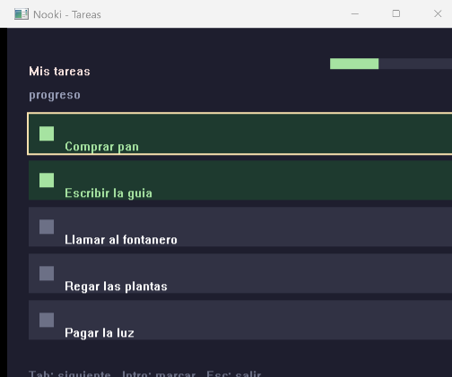

# Ejemplos de Nooki

Cuatro programas que se compilan y se ejecutan. Todos usan solo lo que el compilador soporta hoy.

## Preparar el compilador

Si aún no tienes `nooki` en el `PATH`:

```powershell
# Windows (PowerShell), desde la raíz del repositorio
$env:Path += ";$PWD\build\windows-mingw\compilador"
nooki --version
```

```bash
# Linux y macOS, desde la raíz del repositorio
export PATH="$PWD/build/linux/compilador:$PATH"
nooki --version
```

Para dejarlo fijo, añade esa carpeta al `PATH` de tu sistema.

## Los ejemplos

| Carpeta | Qué muestra |
|---|---|
| `01-hola` | lo mínimo: imprimir y salir |
| `02-notas` | textos, colecciones y funciones |
| `03-inventario` | estructuras, mapas y módulos |
| `04-saludos` | rasgos y despacho dinámico |
| `05-ventana` | una ventana con dibujo |
| `06-tareas` | aplicación con ratón y teclado |
| `07-formulario` | campo de texto editable |
| **`08-red`** | **una red neuronal que aprende un círculo** |
| **`09-clases`** | **tres clases: dos fronteras a la vez** |

### 01 — Hola

```bash
$ nooki ejecutar ejemplos/01-hola/principal.oki
¡Hola, Nooki!
```

El programa mínimo: una función `principal` que devuelve un entero.

### 02 — Notas

Lee líneas `nombre:nota` de la entrada estándar y cuenta cuántas valen, cuántas se rechazan y cuánto
suman.

```bash
$ cd ejemplos/02-notas
$ nooki construir
$ printf "Ana:30\nLuis:25\nmalo\nEva:999\n" | ./principal
2       ← dos notas válidas
2       ← dos rechazadas (sin separador, y fuera de rango)
55      ← suma de las válidas
```

Usa un módulo propio (`biblioteca/notas.oki`), errores como valores (`fallo` con `Vale`/`Falla`) y
`coincide` con ligaduras.

### 03 — Inventario

Clases, herencia y polimorfismo:

```bash
$ nooki ejecutar ejemplos/03-inventario/principal.oki
producto
perecedero
10
10
```

`perecedero` hereda de `producto` y sobrescribe `describir` y `costo`. La llamada `leche.costo()`
despacha a la implementación del hijo.

### 04 — Saludos

Rasgos: el mismo mensaje a dos tipos que no comparten padre.

```bash
$ nooki ejecutar ejemplos/04-saludos/principal.oki
Hola, soy Ana
Bip. Unidad R2
```

`persona` y `robot` implementan `Saluda`; `presentar` recibe `&Saluda` y despacha a cada uno.

### 05 — Ventana

Una ventana real con una interfaz colocada por el módulo de diseño: título, subtítulo, tres botones y
una barra de progreso. Se cierra sola a los dos segundos, o al cerrarla.

```bash
$ nooki ejecutar ejemplos/05-ventana/principal.oki
ventana cerrada
```

Sin entorno gráfico (un servidor, un contenedor) imprime `sin entorno grafico` y termina bien: el
programa decide qué hacer cuando no hay pantalla.

### 06 — Tareas

Una aplicación completa: lista de tareas con casillas, barra de progreso, foco que se recorre con
**Tab**, marcar con **Intro** y salir con **Esc**. Usa los cinco módulos de interfaz.

```bash
$ nooki ejecutar ejemplos/06-tareas/principal.oki
```



La captura la genera `herramientas/capturar.ps1`, que abre el programa, espera a su ventana, la
fotografía y lo cierra.

## Crear uno propio

```bash
$ nooki nuevo mio
$ cd mio
$ nooki construir
$ ./principal
Hola, Nooki
```

La estructura que crea es la que espera `nooki construir`:

```
mio/
  principal.oki
  biblioteca/
    herramientas.oki
```

Y para probarlo:

```
mio/
  pruebas/
    saludo.oki
    saludo.oki.esperado
```

```bash
$ nooki probar
ok    pruebas/saludo.oki
todas las pruebas pasaron
```

## Si algo no compila

El compilador explica qué pasa, dónde y cómo arreglarlo:

```
error[NOK5001]: no se puede usar «a»: el valor se movió antes
  --> ejemplo.oki:3:15
  |
3 |     imprimir(a)
  |               ^
  |
   = ayuda: se movió a otro sitio: use «&» para prestarlo sin transferirlo
```

La [guía](../GUIA.md) explica cada concepto con su programa y su salida real.
